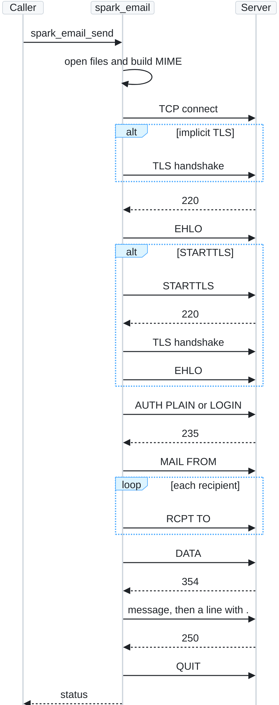
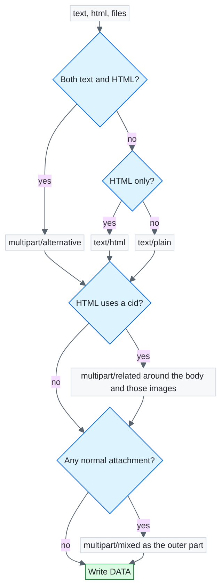

# spark_email

English | [中文](README.zh.md)

Send one message over SMTP from C. `spark_email_send` blocks until the server accepts the message or the attempt fails, then closes the connection.

The header is C. The implementation is C++11. TLS is OpenSSL. This repository does not ship OpenSSL. On an embedded device, set up the library path and the link line yourself. This project links the system OpenSSL with `find_package(OpenSSL)`.

## Features

- One function call sends one message. There is no global state, so calls from several threads do not share a connection.
- Plain text, HTML, inline images, video, and other files. The MIME tree is only as deep as the message needs.
- Non-ASCII subjects and display names are encoded as `=?UTF-8?B?...?=`.
- TLS on 465 is implicit. Any other port must use STARTTLS unless you ask for cleartext. Certificates are checked against the system store.
- Authentication is `AUTH PLAIN` when the server advertises it, otherwise `AUTH LOGIN`. The username is the full address.
- Bcc is an envelope recipient only. It is not written into the header.
- Base64 lines are 76 characters. A line of the message that starts with `.` is escaped before `DATA`.

## Quick start

Requires CMake 3.16 or newer, a C++11 compiler, and OpenSSL headers. The runtime is Linux.

```bash
cmake -S . -B build
cmake --build build
```

That builds `libspark_email.a` and `demo_main`. Passwords are not in this repository. Put the authorization code in the environment, or pass `--password`.

```bash
export SPARK_EMAIL_PASSWORD='authorization-code'
./build/demo_main \
  --host smtp.example.com \
  --user sender@example.com \
  --from 'Monitor <sender@example.com>' \
  --to recipient@example.com \
  --subject 'Bowl visit' \
  --text '14:08 to 14:11 at the bowl.' \
  --html '<p>14:08 to 14:11 at the bowl.</p>' \
  --file snap.jpg|snapshot.jpg|image/jpeg|snap|0 \
  --file clip.mp4|clip.mp4|||0 \
  --file note.txt|note.txt|||0
```

`--file` is `path|name|type|cid|mem`. `mem` of `1` reads the file into memory first. Leave `type` empty and the type comes from the file name extension. A `cid` is inline only when the HTML contains `cid:` and that id. Video stays an attachment.

`--port 0` with `--tls auto` uses 465 and implicit TLS. Port 587 with `auto` requires STARTTLS. `--tls none` is cleartext for a private relay.

## API

```c
SparkEmailStatus spark_email_send(
    const SparkEmailServer *server,
    const SparkEmailMessage *message,
    char *err,
    size_t err_size);
```

Zero a `SparkEmailServer` for the defaults: port 465, implicit TLS, certificate checks, and 30 seconds for each wait. `err` may be NULL. On failure it holds `step -> reason`.

| Value | Meaning |
| --- | --- |
| `0` | Accepted. |
| `-1` | Arguments, a missing file, the certificate, authentication, or a `5xx` reply. Sending the same request again will fail the same way. |
| `-11` | Name lookup, connect, a timeout, or a `4xx` reply. Try again later. A timeout after the final `.` can mean the message was already accepted. |

| Server field | Meaning |
| --- | --- |
| `host` | SMTP host. |
| `port` | `0` picks 465, 587, or 25 from `tls`. |
| `tls` | `auto`, implicit TLS, STARTTLS, or cleartext. |
| `username` | Full address. Empty skips authentication. |
| `password` | Mailbox password or authorization code. |
| `ca_file` | Empty uses the system certificate store. |
| `insecure` | Non-zero skips certificate checks. |
| `timeout_ms` | Limit for one wait, in milliseconds. `0` means 30000. The wait after the final `.` is four times this. |
| `trace` | Optional. Called for each command and reply. Authentication material is replaced with `*`. |

| Message field | Meaning |
| --- | --- |
| `from` | `addr@example.com` or `Name <addr@example.com>`. |
| `to`, `cc` | Comma or semicolon separated. A comma inside a display name needs quotes. |
| `bcc` | Envelope only. |
| `subject`, `text`, `html` | UTF-8. A non-NULL body may be empty. NULL means that body is absent. |
| `files` | Images, video, and other files. |

| File field | Meaning |
| --- | --- |
| `path` | Read this file when `data` is NULL. |
| `data`, `size` | Bytes already in memory, such as a JPEG just encoded. |
| `name` | Name the recipient sees. Required for memory bytes. |
| `type` | Empty selects a type from the extension. |
| `cid` | Inline when the HTML references it. Otherwise the file is an attachment. |

`MAIL FROM` and `RCPT TO` carry the address only. The address in `from` should be the authenticated mailbox.

## Behavior

The library builds the message before it connects. A file that cannot be opened fails with `-1` and does not open a socket. File bytes are read and Base64-encoded while `DATA` is written, so a video is not loaded as one string.

A leaf part is Base64. Text and HTML are converted to CRLF first. The tree is:

- `text/plain` when there is no HTML.
- `text/html` when there is no plain part.
- `multipart/alternative` when both exist.
- `multipart/related` around that body when an HTML `cid:` matches a file.
- `multipart/mixed` as the outer part when any file is a normal attachment.

No text and no HTML still produces an empty `text/plain` part.

The session is one command, then one reply. `EHLO` falls back to `HELO` on a `5xx`. A non-465 port that does not advertise STARTTLS fails instead of staying in cleartext. `PLAIN` is preferred over `LOGIN`. The message is rejected locally when it is larger than the advertised `SIZE`.

## Flow

`spark_email_send` builds the MIME tree, then walks SMTP. Each command waits for its reply code.



The MIME tree adds a layer only when the message needs it.



## Limits

Linux only. One message per connection. No `PIPELINING`, `XOAUTH2`, or non-ASCII mailbox addresses. The link line for a program that uses the static library still needs `libssl`, `libcrypto`, and `pthread`.

## License

This project is licensed under the [MIT License](LICENSE). Copyright (c) 2026 SparkTheCreater.
