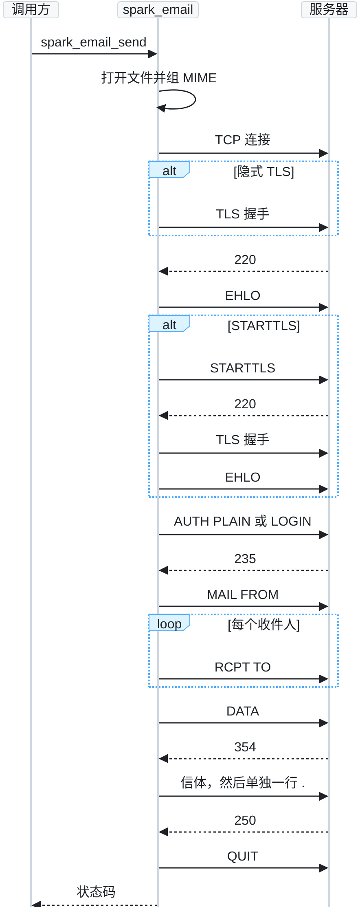
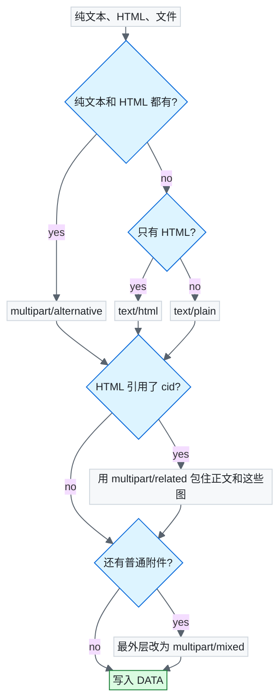

# spark_email

[English](README.md) | 中文

用 C 调用 SMTP 发一封信。`spark_email_send` 会一直阻塞，直到服务器收下这封信，或者这次尝试失败。返回时连接已经关掉。

头文件是 C，实现是 C++11。TLS 用 OpenSSL。这个仓库不附带 OpenSSL。嵌入式设备上的库路径和链接关系需要自己配置。本工程使用 `find_package(OpenSSL)` 链接系统里的 OpenSSL。

## 功能

- 一次调用发一封信。没有全局状态，多个线程同时调用不会共用一条连接。
- 纯文本、HTML、内嵌图片、视频和其他文件。MIME 树只套用到的那几层。
- 主题和显示名里的非 ASCII 写成 `=?UTF-8?B?...?=`。
- 465 走隐式 TLS。其他端口必须 STARTTLS，除非明确要求明文。证书用系统证书库校验。
- 服务器广告了 `AUTH PLAIN` 就用它，否则用 `AUTH LOGIN`。用户名是完整邮箱。
- 密送只出现在信封的收件人里，不写进信头。
- Base64 每行 76 个字符。正文里以 `.` 开头的行会在 `DATA` 之前转义。

## 快速开始

需要 CMake 3.16 或更新版本、C++11 编译器，以及 OpenSSL 头文件。运行环境是 Linux。

```bash
cmake -S . -B build
cmake --build build
```

编出来的是 `libspark_email.a` 和 `demo_main`。仓库里没有口令。授权码放在环境变量里，或者用 `--password` 传入。

```bash
export SPARK_EMAIL_PASSWORD='authorization-code'
./build/demo_main \
  --host smtp.example.com \
  --user sender@example.com \
  --from 'Monitor <sender@example.com>' \
  --to recipient@example.com \
  --subject 'Bowl visit' \
  --text '14:08 to 14:11 at the bowl.' \
  --html '<p>14:08 to 14:11 at the bowl.</p>' \
  --file snap.jpg|snapshot.jpg|image/jpeg|snap|0 \
  --file clip.mp4|clip.mp4|||0 \
  --file note.txt|note.txt|||0
```

`--file` 的五段是路径、显示名、类型、Content-ID、是否先读进内存。最后一段为 `1` 时先读进内存。类型留空时按扩展名判断。只有 HTML 里写了对应的 `cid:`，这个文件才内嵌。视频仍然作为附件。

`--port 0` 且 `--tls auto` 时使用 465 和隐式 TLS。587 配合 `auto` 必须走 STARTTLS。`--tls none` 是明文，只适合内网中继。

## 接口

```c
SparkEmailStatus spark_email_send(
    const SparkEmailServer *server,
    const SparkEmailMessage *message,
    char *err,
    size_t err_size);
```

`SparkEmailServer` 全零就是默认：465 端口、隐式 TLS、校验证书、每次等待 30 秒。`err` 可以为空。失败时里面是 `步骤 -> 原因`。

| 返回值 | 含义 |
| --- | --- |
| `0` | 服务器已收下。 |
| `-1` | 参数、文件打不开、证书、认证，或 `5xx`。原样再发还会失败。 |
| `-11` | 解析、连接、超时，或 `4xx`。可以稍后再试。结束点之后的超时，信有可能已经投递。 |

| 服务器字段 | 含义 |
| --- | --- |
| `host` | SMTP 主机。 |
| `port` | `0` 时按 `tls` 取 465、587 或 25。 |
| `tls` | `auto`、隐式 TLS、STARTTLS 或明文。 |
| `username` | 完整邮箱。空字符串表示不认证。 |
| `password` | 邮箱密码或授权码。 |
| `ca_file` | 空则使用系统证书库。 |
| `insecure` | 非零则不校验证书。 |
| `timeout_ms` | 每一次等待的上限，单位毫秒。`0` 为 30000。等结束点之后的回复时放大到 4 倍。 |
| `trace` | 可空。每条命令和响应调用一次。认证内容会换成 `*`。 |

| 邮件字段 | 含义 |
| --- | --- |
| `from` | `addr@example.com`，或 `名字 <addr@example.com>`。 |
| `to`、`cc` | 用逗号或分号分隔。显示名里的逗号要加引号。 |
| `bcc` | 只进信封。 |
| `subject`、`text`、`html` | UTF-8。正文指针非空时可以是空串。NULL 表示没有这一段。 |
| `files` | 图片、视频和其他文件。 |

| 文件字段 | 含义 |
| --- | --- |
| `path` | `data` 为空时读取这个路径。 |
| `data`、`size` | 已经在内存里的字节，例如刚编好的 JPEG。 |
| `name` | 收件人看到的文件名。内存数据必须填写。 |
| `type` | 空则按扩展名选择类型。 |
| `cid` | HTML 引用了它才内嵌，否则是附件。 |

`MAIL FROM` 和 `RCPT TO` 里只有邮箱地址。`from` 里的地址应与登录的邮箱一致。

## 行为

库在连接之前就把信排好。文件打不开时返回 `-1`，不会去连服务器。文件内容在写 `DATA` 时边读边做 Base64，视频不会先变成一整段字符串。

叶子段都是 Base64。纯文本和 HTML 会先把换行变成 CRLF。树是这样选的：

- 没有 HTML 时是 `text/plain`。
- 没有纯文本时是 `text/html`。
- 两者都有时是 `multipart/alternative`。
- HTML 里的 `cid:` 对上了某个文件时，外面再套 `multipart/related`。
- 还有普通附件时，最外层是 `multipart/mixed`。

纯文本和 HTML 都没有时，仍会放一段空的 `text/plain`。

会话是一问一答。`EHLO` 收到 `5xx` 会退回 `HELO`。不是 465 的端口如果没有广告 STARTTLS，会直接失败，不会留在明文。有 `PLAIN` 就不用 `LOGIN`。信的大小超过服务器广告的 `SIZE` 时，在 `MAIL FROM` 之前就失败。

## 流程

`spark_email_send` 先组 MIME，再走 SMTP。每条命令都等到对应的响应码。



MIME 只在需要那一层时才套上去。



## 范围

只支持 Linux。一条连接只发一封信。没有 `PIPELINING`、`XOAUTH2`，也不支持非 ASCII 邮箱地址。使用这个静态库的程序，链接时仍然要带上 `libssl`、`libcrypto` 和 `pthread`。
